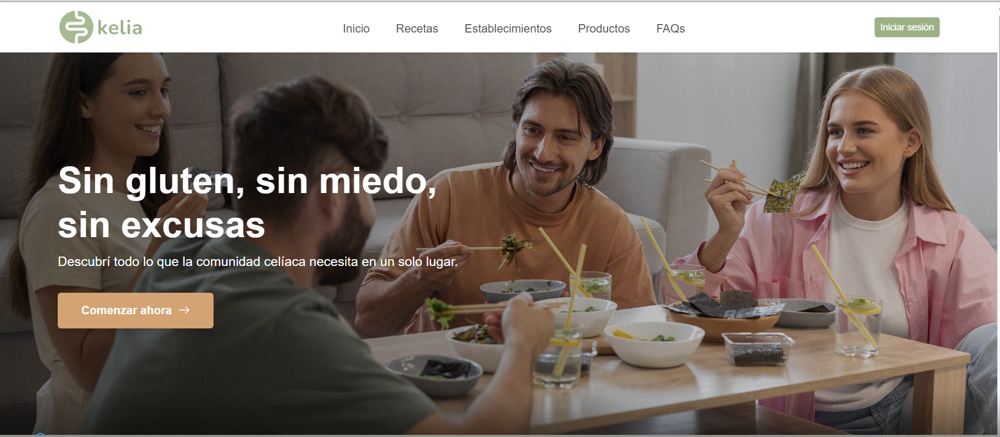
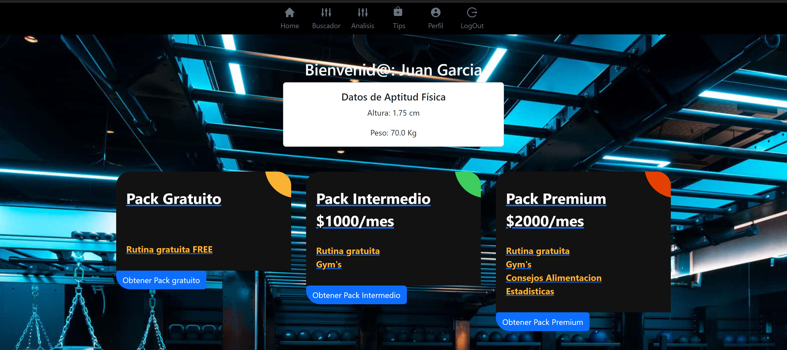
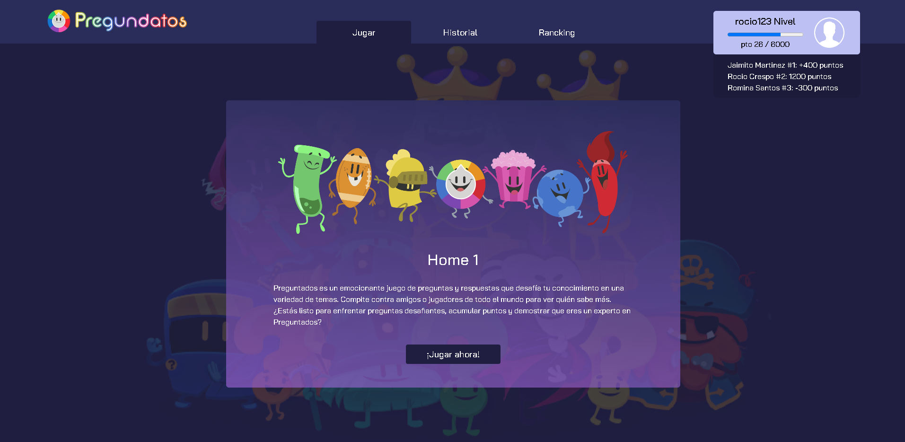
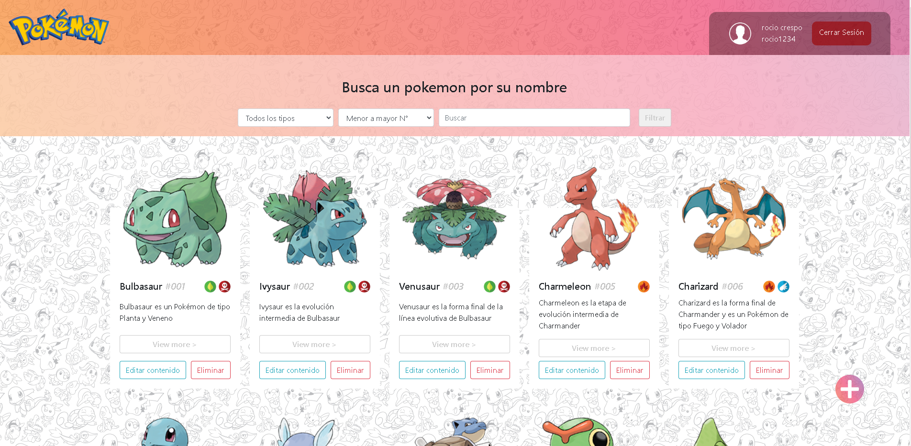

<h1 align="center">¡Hola! 👋 Soy Karen Nina</h1>

<h3 align="center">Desarrollo de Software Junior | Backend Java | QA Testing | IT Trainee</h3>

  🎓 Técnica Universitaria en Web — Universidad Nacional de La Matanza (UNLaM) 
  Plan de estudios completo · Título en trámite desde septiembre de 2026

  Busco mi primera oportunidad profesional en el área IT, en <strong>desarrollo de software, Backend Java, QA/Testing o soporte de aplicaciones</strong>, en posiciones Junior o Trainee.

  
  

---

## 🚀 Proyectos académicos

### Proyectos destacados

| Kelia — Plataforma para la comunidad celíaca (2025) | AppEntrenamiento |
| :---: | :---: |
|  |  |
| Plataforma colaborativa sobre productos sin gluten, recetas y establecimientos. **Proyecto final integrador grupal de UNLaM; participación principalmente Backend.** | Aplicación web para organizar entrenamientos, generar rutinas y acompañar el seguimiento físico. **Proyecto académico grupal.** |
| **Java · Spring Boot · JPA/Hibernate · PostgreSQL · MongoDB · React · Firebase · JUnit · Mockito** | **Java · Spring MVC · Hibernate · MySQL · Thymeleaf · Bootstrap** |
| 📁 [Ver repositorio](https://github.com/Karen-nina/Kelia) | 📁 [Ver repositorio](https://github.com/Karen-nina/AppEntrenamiento) |

### Otros proyectos

| Preguntados | Pokédex | Unflix |
| :---: | :---: | :---: |
|  |  |  |
| Juego web de preguntas | Práctica de desarrollo web | Interfaz de catálogo audiovisual |
| PHP · JavaScript | Desarrollo web | HTML · CSS · JavaScript |
| [Ver proyecto](https://github.com/Karen-nina/Preguntados) | [Ver proyecto](https://github.com/Karen-nina/Pokedex) | [Ver proyecto](https://github.com/Karen-nina/Unflix) |

---

## 🛠️ Lenguajes y herramientas

  
  
  
  
  
  
  
  
  
  
  
  
  
  
  

- **Backend:** Java, Spring Boot, Spring Data JPA, Hibernate y Spring Security.
- **Testing:** JUnit y pruebas unitarias.
- **Bases de datos:** SQL, PostgreSQL y MySQL; conocimientos académicos de MongoDB.
- **Trabajo colaborativo:** Git, GitHub, Scrum y metodologías ágiles.
- **Otras tecnologías estudiadas:** JavaScript, HTML, CSS, PHP, Laravel, C# y ASP.NET Core.

## 🤝 Experiencia y habilidades transferibles

También soy **Enfermera Universitaria (UNLaM, 2019)**. Mi experiencia en el ámbito de la salud fortaleció habilidades de **trabajo interdisciplinario, documentación, atención al detalle y resolución de problemas**, que puedo aplicar a los equipos de tecnología.

## 📫 Contacto

  
  

**Disponibilidad:** full-time o part-time · presencial en CABA y alrededores · híbrida o remota.
